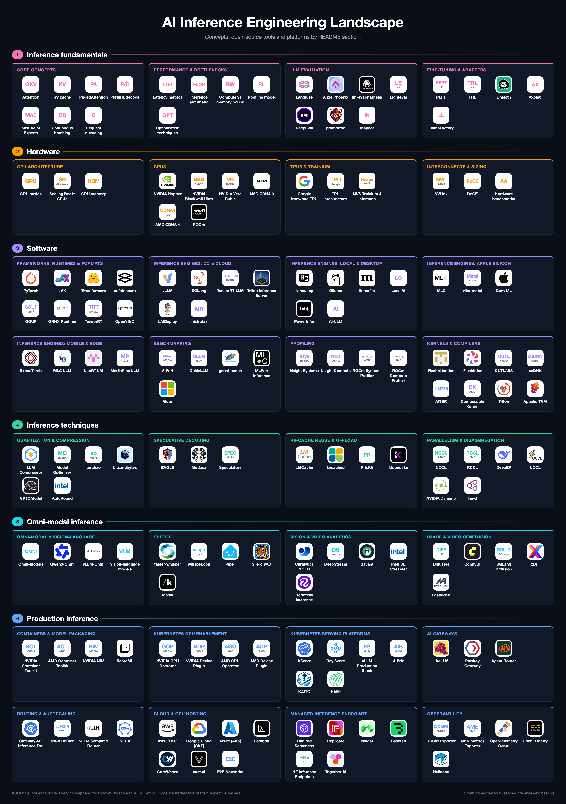

# Awesome Inference Engineering 

This is a curated collection of inference fundamentals, open-source inference engines, research papers, benchmarks, and practical guides for engineers who want to understand what happens when a model runs, and what it takes to run it well in production.

It starts with the basics of model serving, then goes deeper into the hardware and systems underneath and the optimisations that make inference faster and cheaper. It later covers multimodal inference, including image and video generation, and running all of these workloads in production and scaling them. 

## Table of contents

- [1. Inference fundamentals](#fundamentals)
  - [1.1 What inference is](#what-is-inference)
  - [1.2 Transformers, attention and the KV cache](#transformers-and-kv-cache)
  - [1.3 Prefill, decode and serving modes](#prefill-and-decode)
  - [1.4 Latency and throughput metrics](#latency-metrics)
  - [1.5 Model selection, evaluation and compression](#model-strategy)
- [2. Hardware](#hardware)
  - [2.1 GPU architecture](#gpu-architecture)
  - [2.2 Accelerators by vendor](#accelerators-by-vendor)
  - [2.3 Instances, interconnects and sizing](#instances-and-interconnects)
  - [2.4 Local and edge inference](#local-and-edge-inference)
- [3. Software](#software)
  - [3.1 Frameworks and model formats](#frameworks-and-formats)
  - [3.2 Inference engines](#inference-engines)
  - [3.3 Benchmarking and profiling](#benchmarking-and-profiling)
  - [3.4 Kernel libraries and languages](#kernel-libraries)
  - [3.5 GEMM kernels and tile programming](#gemm-kernels)
- [4. Inference techniques](#inference-techniques)
  - [4.1 Bottleneck analysis](#bottleneck-analysis)
  - [4.2 Batching and attention optimization](#batching-and-attention)
  - [4.3 Quantization](#quantization)
  - [4.4 Speculative decoding](#speculative-decoding)
  - [4.5 KV-cache reuse, routing and offload](#kv-cache)
  - [4.6 Long-context handling](#long-context)
  - [4.7 Parallelism and communication](#parallelism-and-communication)
  - [4.8 Disaggregation](#disaggregation)
- [5. Omni-model inference](#beyond-llms)
  - [5.1 Vision-language models](#vision-language-models)
  - [5.2 Omni-modal models](#omni-modal-models)
  - [5.3 Speech](#speech)
  - [5.4 Image and video generation](#image-and-video-generation)
- [6. Production inference](#production)
  - [6.1 Containers and GPU enablement](#containers-and-gpus)
  - [6.2 Kubernetes serving platforms](#kubernetes-serving)
  - [6.3 Routing and autoscaling](#routing-and-autoscaling)
  - [6.4 Cloud platforms](#cloud-platforms)
  - [6.5 Observability, security and debugging](#observability-and-reliability)
  - [6.6 Cost and efficiency](#cost-and-efficiency)
  - [6.7 Case studies](#case-studies)
- [7. Learning resources](#learning)
  - [7.1 Courses and books](#courses-and-books)
  - [7.2 Talks](#talks)
- [8. Contributing](#contributing)
- [9. License](#license)

## 1. Inference fundamentals

### 1.1 What inference is

- [The Difference Between AI Training and Inference](https://nebius.com/blog/posts/difference-between-ai-training-and-inference) - How serving a trained model differs from training it.
- [How LLM Inference Works](https://arpitbhayani.me/blogs/how-llm-inference-works) - Prompt-to-response walkthrough of tokenization, embedding and autoregressive generation.
- [Mastering LLM Techniques: Inference Optimization](https://developer.nvidia.com/blog/mastering-llm-techniques-inference-optimization/) - Prefill and decode, compute and memory limits, batching and KV-cache trade-offs.
- [Top 5 AI Model Optimization Techniques for Faster, Smarter Inference](https://developer.nvidia.com/blog/top-5-ai-model-optimization-techniques-for-faster-smarter-inference/) - Overview of model-level optimizations, such as quantization and pruning, for inference latency and cost.
- [Open-Source LLMs vs Closed](https://hatchworks.com/blog/gen-ai/open-source-vs-closed-llms-guide/) - Trade-offs between open-weight and closed, API-only models.

### 1.2 Transformers, attention and the KV cache

- [The Illustrated Transformer](https://jalammar.github.io/illustrated-transformer/) - Diagram-led walkthrough of self-attention and the encoder-decoder transformer.
- [KV Caching Explained](https://huggingface.co/blog/not-lain/kv-caching) - How caching keys and values speeds up transformer decoding.
- [What Is a KV Cache, and Why Does It Make LLM Inference Faster?](https://sebastianraschka.com/faq/docs/kv-cache.html) - What the KV cache stores and why LLM inference depends on it.
- [Mixture of Experts Explained](https://huggingface.co/blog/moe) - How sparse expert layers work, and what they change for training and inference.

### 1.3 Prefill, decode and serving modes

- [Prefill vs Decode](https://redis.io/blog/prefill-vs-decode/) - Why prefill is compute-bound and decode is memory-bound.
- [Using Asynchronous Inference in Production](https://www.baseten.co/blog/using-asynchronous-inference-in-production/) - Queue-based inference for long-running or bursty workloads.

### 1.4 Latency and throughput metrics

- [LLM Inference Benchmarking: Fundamental Concepts](https://developer.nvidia.com/blog/llm-benchmarking-fundamental-concepts/) - Definitions of TTFT, inter-token latency, tokens per second and end-to-end latency.
- [NIM LLM Benchmarking Metrics](https://docs.nvidia.com/nim/benchmarking/llm/metrics) - How NVIDIA defines and measures TTFT, inter-token latency, throughput and request latency.

### 1.5 Model selection, evaluation and compression

- [Choosing the Right Model](https://handbook.modular.com/getting-started/choosing-the-right-model/) - Criteria for picking an open model for a given task, size and budget.
- [LLM Benchmarking Framework with LLM-as-a-JURY](https://github.com/aws-samples/sample-bedrock-migration-and-modernization-tools/blob/main/360-eval/README.md) - AWS 360-Eval, which benchmarks candidate models on your own data using a jury of LLM judges.
- [LLM Evaluation: A Beginner's Guide](https://www.evidentlyai.com/llm-guide/llm-evaluation) - Evaluation methods for LLM systems, from benchmarks to LLM-as-a-judge.
- [PEFT](https://github.com/huggingface/peft) - Parameter-efficient fine-tuning methods such as LoRA, which produce small adapters that engines can serve together on one base model.
- [LLM Model Pruning and Knowledge Distillation with NVIDIA NeMo Framework](https://developer.nvidia.com/blog/llm-model-pruning-and-knowledge-distillation-with-nvidia-nemo-framework/) - Producing a smaller student model through pruning and distillation.

## 2. Hardware

### 2.1 GPU architecture

- [Intro to GPUs for the Researcher](https://hackbot.dad/writing/intro-to-gpus/) - Practical GPU mental model aimed at raising model FLOPS utilization.
- [How to Think About GPUs](https://jax-ml.github.io/scaling-book/gpus/) - How GPU chips and their networks work, and what that means for LLMs.
- [What Is GPU Memory and Why It Matters for LLM Inference](https://www.bentoml.com/blog/what-is-gpu-memory-and-why-it-matters-for-llm-inference) - How weights, KV cache and activations compete for VRAM.

### 2.2 Accelerators by vendor

#### NVIDIA

- [NVIDIA Hopper Architecture In-Depth](https://developer.nvidia.com/blog/nvidia-hopper-architecture-in-depth/) - Architecture guide to the NVIDIA H100 Tensor Core GPU.
- [Inside NVIDIA Blackwell Ultra](https://developer.nvidia.com/blog/inside-nvidia-blackwell-ultra-the-chip-powering-the-ai-factory-era/) - Blackwell Ultra architecture, NVFP4 and attention-layer acceleration.
- [Inside the NVIDIA Vera Rubin Platform](https://developer.nvidia.com/blog/inside-the-nvidia-rubin-platform-six-new-chips-one-ai-supercomputer/) - Vendor overview of the Vera Rubin rack-scale platform and its chips, including the Vera CPU.

#### AMD

- [AMD CDNA 3 Architecture White Paper](https://www.amd.com/content/dam/amd/en/documents/instinct-tech-docs/white-papers/amd-cdna-3-white-paper.pdf) - Architecture of the MI300 series, including chiplets and memory.
- [AMD CDNA 4 Architecture White Paper](https://www.amd.com/content/dam/amd/en/documents/instinct-tech-docs/white-papers/amd-cdna-4-architecture-whitepaper.pdf) - Architecture of the MI350 series and its low-precision data types.
- [ROCm Documentation](https://rocm.docs.amd.com/en/latest/) - Documentation for AMD's ROCm software platform for Instinct accelerators.

#### Google TPU

- [The Chip Made for the AI Inference Era: The Google TPU](https://www.uncoveralpha.com/p/the-chip-made-for-the-ai-inference) - Technical and strategic overview of Google TPUs.
- [TPU Architecture](https://docs.cloud.google.com/tpu/docs/system-architecture-tpu-vm) - Official reference for TensorCores, MXUs, slices, pods and multislice topologies.
- [How to Think About TPUs](https://jax-ml.github.io/scaling-book/tpus/) - TPU compute, memory and interconnect explained for model workloads.

### 2.3 Instances, interconnects and sizing

- [NVLink and NVLink Switch](https://www.nvidia.com/en-us/data-center/nvlink/) - Vendor overview of NVIDIA's GPU-to-GPU interconnect and switch fabric.
- [RoCEv2 for Deep Learning](https://iodized-hawthorn-94a.notion.site/RoCEv2-26954c8e1f0a80b78bf1c6adc583e670) - Introduction to RDMA over Converged Ethernet for GPU clusters.
- [Amazon EC2 Instance Types](https://aws.amazon.com/ec2/instance-types/) - AWS accelerated-computing families for GPU, Trainium and Inferentia.
- [Google Cloud GPU Machine Types](https://docs.cloud.google.com/compute/docs/gpus) - GPU models, machine families and regional availability on Compute Engine.
- [Azure VM Sizes](https://learn.microsoft.com/en-us/azure/virtual-machines/sizes/overview) - Azure VM families, including the GPU-accelerated N-series.
- [Artificial Analysis Hardware Benchmarks](https://artificialanalysis.ai/hardware-inference-stack/) - Independent throughput, speed and cost benchmarks of inference hardware, from datacenter systems to laptops and phones.

### 2.4 Local and edge inference

#### Desktop

- [llama.cpp](https://github.com/ggml-org/llama.cpp) - LLM inference in C/C++ with its own quantized model formats.
- [Ollama](https://github.com/ollama/ollama) - Downloads and runs open models locally behind a simple API.
- [PowerInfer](https://github.com/Tiiny-AI/PowerInfer) - Consumer-GPU engine exploiting activation sparsity across GPU and CPU.
- [AirLLM](https://github.com/lyogavin/airllm) - Layer-by-layer loading that runs large models on small GPUs at the cost of latency.

#### Apple Silicon

- [MLX](https://github.com/ml-explore/mlx) - Array framework for machine learning on Apple Silicon.
- [MLX LM](https://github.com/ml-explore/mlx-lm) - Running and fine-tuning LLMs with MLX on Apple Silicon.
- [vllm-metal](https://github.com/vllm-project/vllm-metal) - Community plugin for running vLLM on Apple Silicon GPUs.
- [On-Device Llama 3.1 with Core ML](https://machinelearning.apple.com/research/core-ml-on-device-llama) - Apple's walkthrough of optimizing an LLM for on-device Core ML inference.

#### Mobile

- [ExecuTorch](https://github.com/pytorch/executorch) - PyTorch runtime for on-device inference on mobile and embedded hardware.
- [MLC LLM](https://github.com/mlc-ai/mlc-llm) - Compiler-based deployment of LLMs to phones, browsers and GPUs.
- [MediaPipe LLM Inference](https://developers.google.com/edge/mediapipe/solutions/genai/llm_inference) - Google AI Edge API for running LLMs on Android, iOS and the web.

## 3. Software

### 3.1 Frameworks and model formats

- [PyTorch](https://github.com/pytorch/pytorch) - Core framework, including torch.compile and the PyTorch profiler.
- [JAX](https://github.com/jax-ml/jax) - Composable transformations and XLA compilation, widely used on TPUs.
- [Transformers](https://github.com/huggingface/transformers) - Hugging Face model definitions for text, vision, audio and multimodal models, used for both inference and training.
- [Tokenizers](https://github.com/huggingface/tokenizers) - Fast tokenizer implementations used by most open language models.
- [Common AI Model Formats](https://huggingface.co/blog/ngxson/common-ai-model-formats) - Comparison of GGUF, safetensors, PyTorch and ONNX formats.
- [safetensors](https://github.com/safetensors/safetensors) - Safe, zero-copy tensor serialization format used by most open checkpoints.
- [GGUF](https://github.com/ggml-org/ggml/blob/master/docs/gguf.md) - Specification of the single-file quantized model format used by llama.cpp.
- [ONNX Runtime](https://github.com/microsoft/onnxruntime) - Cross-platform inference runtime for ONNX models.
- [TensorRT](https://github.com/NVIDIA/TensorRT) - NVIDIA SDK that compiles and optimizes models for inference on NVIDIA GPUs.

### 3.2 Inference engines

- [vLLM](https://github.com/vllm-project/vllm) - High-throughput, memory-efficient LLM serving engine with continuous batching and PagedAttention.
- [SGLang](https://github.com/sgl-project/sglang) - High-performance serving framework for language and multimodal models.
- [TensorRT-LLM](https://github.com/NVIDIA/TensorRT-LLM) - NVIDIA library and runtime for optimized LLM inference on NVIDIA GPUs.
- [LMDeploy](https://github.com/InternLM/lmdeploy) - Toolkit for compressing, deploying and serving LLMs.
- [mistral.rs](https://github.com/EricLBuehler/mistral.rs) - Fast LLM inference engine written in Rust.

### 3.3 Benchmarking and profiling

- [GuideLLM](https://github.com/vllm-project/guidellm) - vLLM project's tool for benchmarking deployments against realistic traffic.
- [genai-bench](https://github.com/sgl-project/genai-bench) - SGLang's token-level benchmark for LLM serving endpoints.
- [AIPerf](https://github.com/ai-dynamo/aiperf) - Generative AI load testing, trace replay and SLO analysis.
- [llm-inference-benchmark](https://github.com/winderai/llm-inference-benchmark) - Reproducible comparison of vLLM, SGLang, TensorRT-LLM, llama.cpp and Ollama on a single H100.
- [MLPerf Inference](https://github.com/mlcommons/inference) - Reference implementations of the MLPerf Inference benchmarks.
- [Vidur](https://github.com/microsoft/vidur) - Simulator that estimates LLM serving performance across configurations without running them.
- [Host Overhead is Killing Your Inference Efficiency](https://modal.com/blog/host-overhead-inference-efficiency) - How CPU-side work starves the GPU and how to find it.
- [PyTorch and CPU-GPU Synchronizations](https://tomasruizt.github.io/posts/08_cpu_gpu_synchronization/) - Spotting and removing hidden synchronization points.
- [Nsight Systems User Guide](https://docs.nvidia.com/nsight-systems/UserGuide/index.html) - NVIDIA's system-wide timeline profiler for CPU, GPU and communication activity.
- [ROCm Systems Profiler](https://rocm.docs.amd.com/projects/rocprofiler-systems/en/latest/) - AMD's system-wide timeline profiler for CPU and GPU activity.
- [Nsight Compute Profiling Guide](https://docs.nvidia.com/nsight-compute/ProfilingGuide/index.html) - Profiling CUDA kernels and interpreting hardware metrics.
- [ROCm Compute Profiler](https://rocm.docs.amd.com/projects/rocprofiler-compute/en/latest/) - Kernel-level performance analysis for AMD Instinct GPUs.

### 3.4 Kernel libraries and languages

- [CUTLASS](https://github.com/NVIDIA/cutlass) - CUDA C++ templates and Python DSLs for high-performance GEMM and related kernels.
- [cuDNN Frontend](https://github.com/NVIDIA/cudnn-frontend) - C++ and Python API for cuDNN graph operations, including fused attention.
- [AITER](https://github.com/ROCm/aiter) - AI Tensor Engine for ROCm: optimized inference operators for AMD GPUs.
- [Composable Kernel](https://github.com/ROCm/rocm-libraries/tree/develop/projects/composablekernel) - AMD's templated library for fused GEMM, attention and other operators.
- [Triton](https://github.com/triton-lang/triton) - Language and compiler for writing GPU kernels in Python.
- [Learn by Doing: TorchInductor Reduction Kernels](https://karthick.ai/blog/2025/Learn-By-Doing-Torchinductor-Reduction/) - How TorchInductor generates reduction kernels.
- [Apache TVM](https://github.com/apache/tvm) - Open machine learning compiler framework.

### 3.5 GEMM kernels and tile programming

- [How to Optimize a CUDA Matmul Kernel for cuBLAS-like Performance](https://siboehm.com/articles/22/CUDA-MMM) - Step-by-step path from a naive kernel to near-cuBLAS performance.
- [Outperforming cuBLAS on H100](https://cudaforfun.substack.com/p/outperforming-cublas-on-h100-a-worklog) - Worklog of Hopper-specific matmul optimizations.
- [Inside NVIDIA GPUs: Anatomy of High-Performance Matmul Kernels](https://www.aleksagordic.com/blog/matmul) - From PTX/SASS to warp tiling and asynchronous tensor-core pipelines.
- [Categorical Foundations for CuTe Layouts](https://research.colfax-intl.com/categorical-foundations-for-cute-layouts/) - The mathematics behind CuTe's layout algebra.
- [Demystifying Numeric Conversions in CuTeDSL](https://veitner.bearblog.dev/demystifying-numeric-conversions-in-cutedsl/) - Type-conversion primitives in CuTeDSL.
- [Blackwell Pipelining with CuTeDSL](https://veitner.bearblog.dev/blackwell-pipelining-with-cutedsl/) - Overlapping work with CuTeDSL asynchronous pipelines on Blackwell.

## 4. Inference techniques

### 4.1 Bottleneck analysis

- [Transformer Inference Arithmetic](https://kipp.ly/p/transformer-inference-arithmetic) - Back-of-the-envelope compute and memory math for transformer inference.
- [How Fast Can We Perform a Forward Pass?](https://bounded-regret.ghost.io/how-fast-can-we-perform-a-forward-pass/) - Theoretical and practical limits on forward-pass latency.
- [Making Deep Learning Go Brrrr From First Principles](https://horace.io/brrr_intro.html) - Separates compute, memory-bandwidth and overhead bottlenecks.
- [A Guide to LLM Inference and Performance](https://www.baseten.co/blog/llm-transformer-inference-guide/) - Ops:byte ratio, arithmetic intensity and memory bandwidth applied to choosing a GPU.
- [What Is the Roofline Model?](https://modal.com/gpu-glossary/perf/roofline-model) - Short definition of the roofline model with a worked diagram.
- [GPU Performance Background User's Guide](https://docs.nvidia.com/deeplearning/performance/dl-performance-gpu-background/index.html) - NVIDIA's background guide to math-bound and memory-bound operations.
- [All About Rooflines](https://jax-ml.github.io/scaling-book/roofline/) - Roofline analysis and arithmetic intensity applied to model workloads.

### 4.2 Batching and attention optimization

- [Continuous Batching from First Principles](https://huggingface.co/blog/continuous_batching) - Hugging Face walkthrough from static batching to iteration-level scheduling.
- [Continuous Batching: Optimizing LLM Inference Throughput](https://mbrenndoerfer.com/writing/continuous-batching) - Interactive explanation of how requests join and leave a running batch.
- [Efficient Request Queueing](https://huggingface.co/blog/tngtech/llm-performance-request-queueing) - How queueing in front of an LLM server affects latency and throughput under load.
- [FlashAttention](https://arxiv.org/html/2205.14135v2) - IO-aware exact attention that tiles computation to avoid materializing the attention matrix.
- [Paged Attention from First Principles](https://hamzaelshafie.bearblog.dev/paged-attention-from-first-principles-a-view-inside-vllm/) - PagedAttention explained from virtual-memory basics.
- [Efficient Memory Management for Large Language Model Serving with PagedAttention](https://arxiv.org/abs/2309.06180) - The vLLM paper introducing paged KV-cache memory management.
- [FlashInfer](https://github.com/flashinfer-ai/flashinfer) - Kernel library for LLM serving, focused on attention and sampling.
- [xFormers](https://github.com/facebookresearch/xformers) - Composable, optimized transformer building blocks, including memory-efficient attention.

### 4.3 Quantization

- [A Visual Guide to Quantization](https://newsletter.maartengrootendorst.com/p/a-visual-guide-to-quantization) - Illustrated introduction to LLM quantization.
- [Post Training Quantization](https://liyuan24.github.io/writings/2026_01_06_post_training_quantization.html) - Detailed walkthrough of post-training weight quantization.
- [Quantization-Aware Training for Large Language Models with PyTorch](https://pytorch.org/blog/quantization-aware-training/) - Recovering accuracy lost to quantization by simulating it during training.
- [INT vs FP](https://github.com/ChenMnZ/INT_vs_FP) - Framework comparing low-bit integer and floating-point formats.

### 4.4 Speculative decoding

- [Fast Inference from Transformers via Speculative Decoding](https://arxiv.org/html/2211.17192v2) - The original draft-target speculative decoding paper.
- [EAGLE](https://github.com/SafeAILab/EAGLE) - Official implementation of the EAGLE-1, EAGLE-2 and EAGLE-3 speculative decoding methods.
- [Medusa](https://github.com/FasterDecoding/Medusa) - Multiple decoding heads for candidate token generation.
- [Speculators: Production-Ready Speculative Decoding](https://developers.redhat.com/articles/2025/11/19/speculators-standardized-production-ready-speculative-decoding) - Why the speculators library standardizes draft-model formats.

### 4.5 KV-cache reuse, routing and offload

- [Prompt Caching](https://ngrok.com/blog/prompt-caching/) - Detailed explanation of how cached prompt tokens skip recomputation and why that makes them cheaper.
- [vLLM Automatic Prefix Caching](https://docs.vllm.ai/en/latest/design/prefix_caching/) - Design of vLLM's hash-based prefix cache.
- [Fast and Expressive LLM Inference with RadixAttention and SGLang](https://www.lmsys.org/blog/2024-01-17-sglang/) - Radix-tree KV-cache reuse across requests in SGLang.
- [Ray Serve: Reduce LLM Inference Latency by 60% with Custom Request Routing](https://www.anyscale.com/blog/ray-serve-faster-first-token-custom-routing) - Prefix-aware routing to cut TTFT in multi-turn chat.
- [KV-Cache Wins You Can See](https://llm-d.ai/blog/kvcache-wins-you-can-see) - Prefix-, load- and SLO-aware routing in llm-d.
- [How to Reduce KV Cache Bottlenecks with NVIDIA Dynamo](https://developer.nvidia.com/blog/how-to-reduce-kv-cache-bottlenecks-with-nvidia-dynamo/) - KV-cache offload and reuse in Dynamo.
- [Inside vLLM's New KV Offloading Connector](https://vllm.ai/blog/2026-01-08-kv-offloading-connector) - Offloading KV-cache to CPU DRAM and tuning host-to-device throughput.
- [LMCache](https://github.com/LMCache/LMCache) - KV-cache layer that stores and reuses KV cache across GPU, CPU, disk and remote tiers.
- [PrisKV](https://aibrix.github.io/posts/2025-11-26-priskv-intro/) - Colocated, tiered KV-cache store from the AIBrix project.
- [kvcached](https://github.com/ovg-project/kvcached) - Elastic, virtualized KV-cache that lets multiple models share a GPU.

### 4.6 Long-context handling

- [Rotary Embeddings: A Relative Revolution](https://blog.eleuther.ai/rotary-embeddings/) - Explains RoPE, the position encoding most context-extension methods modify.
- [RoFormer](https://arxiv.org/abs/2104.09864) - The paper that introduced rotary position embeddings (RoPE).
- [DroPE](https://pub.sakana.ai/DroPE/) - Extends context by dropping positional embeddings instead of long-context fine-tuning.
- [Ring Attention with Blockwise Transformers for Near-Infinite Context](https://arxiv.org/abs/2310.01889) - Splitting long sequences across devices with blockwise attention passed around a ring.
- [Evaluating Long Context (Reasoning) Ability](https://nrehiew.github.io/blog/long_context/) - Why models degrade well before their advertised context length, measured on LongCodeEdit.

### 4.7 Parallelism and communication

- [How Multi-Node Inference Works for Massive LLMs like DeepSeek-R1](https://www.baseten.co/blog/how-multi-node-inference-works-llms-deepseek-r1/) - Why DeepSeek-R1 needs 16 H100s across two nodes, and how multi-node serving connects them.
- [Shift Parallelism](https://arxiv.org/abs/2509.16495) - Switching between tensor and data parallelism to balance latency and throughput.
- [vLLM Large Scale Serving: DeepSeek @ 2.2k tok/s/H200 with Wide-EP](https://vllm.ai/blog/2025-12-17-large-scale-serving) - Wide expert parallelism, dual-batch overlap and disaggregated serving for DeepSeek on H200 clusters.
- [Streamlined Multi-Node Serving with Ray symmetric-run](https://vllm.ai/blog/2025-11-22-ray-symmetric-run) - Launching multi-node vLLM on HPC-style clusters with one command.
- [NCCL](https://github.com/NVIDIA/nccl) - NVIDIA collective communication library for multi-GPU and multi-node transfers.
- [RCCL](https://github.com/ROCm/rocm-systems/tree/develop/projects/rccl) - AMD's collective communication library for ROCm GPUs.
- [rocSHMEM](https://github.com/ROCm/rocm-systems/tree/develop/projects/rocshmem) - AMD's GPU-initiated OpenSHMEM communication library.
- [DeepEP](https://github.com/deepseek-ai/DeepEP) - Expert-parallel communication library for MoE dispatch and combine.
- [UCCL](https://github.com/uccl-project/uccl) - GPU communication library for collectives, P2P KV transfer and expert parallelism.

### 4.8 Disaggregation

- [Disaggregated Inference: 18 Months Later](https://haoailab.com/blogs/distserve-retro/) - DistServe authors' retrospective on prefill/decode disaggregation adoption.
- [Disaggregated Inference at Scale with PyTorch and vLLM](https://pytorch.org/blog/disaggregated-inference-at-scale-with-pytorch-vllm/) - Running separate prefill and decode pools with vLLM.
- [Disaggregated Serving in TensorRT-LLM](https://github.com/NVIDIA/TensorRT-LLM/blob/main/docs/source/blogs/tech_blog/blog05_Disaggregated_Serving_in_TensorRT-LLM.md) - TensorRT-LLM's disaggregated serving design.
- [SGLang PD Disaggregation](https://docs.sglang.io/docs/advanced_features/pd_disaggregation) - Configuring prefill/decode disaggregation in SGLang.
- [NVIDIA Dynamo](https://github.com/ai-dynamo/dynamo) - Datacenter-scale distributed inference serving framework with disaggregated prefill and decode.
- [llm-d Architecture](https://llm-d.ai/docs/architecture) - Component design and topology of llm-d.
- [llm-d](https://github.com/llm-d/llm-d) - Kubernetes-native distributed LLM inference with KV-cache-aware scheduling.
- [Mooncake](https://github.com/kvcache-ai/Mooncake) - KV-cache-centric disaggregated serving platform behind Moonshot AI's Kimi.

## 5. Omni-model inference

### 5.1 Vision-language models

- [Vision Language Models Explained](https://huggingface.co/blog/vlms) - Hugging Face introduction to VLM architectures, training and how to choose one.
- [Vision Language Models (Better, Faster, Stronger)](https://huggingface.co/blog/vlms-2025) - Hugging Face update on newer VLM trends, including any-to-any models, reasoning, small models and MoE decoders.
- [Vision Language Models](https://www.baseten.co/inference-engineering/book/06-modalities/vision-language-models/) - Inference Engineering book chapter on serving models that take images and video, and the cost of the vision encoder.
- [vLLM Multimodal Inputs](https://docs.vllm.ai/en/latest/features/multimodal_inputs/) - Passing images, video and audio to multimodal models in vLLM.
- [Vision Language Model Prompt Engineering Guide for Image and Video Understanding](https://developer.nvidia.com/blog/vision-language-model-prompt-engineering-guide-for-image-and-video-understanding/) - NVIDIA guide to feeding single images, multiple images and video frames to VLMs.

### 5.2 Omni-modal models

- [What Is an Omni-Model?](https://www.nvidia.com/en-us/glossary/omni-model/) - NVIDIA definition of models that take and produce several modalities.
- [Qwen2.5-Omni Technical Report](https://arxiv.org/abs/2503.20215) - Thinker-talker architecture that reads text, images, audio and video and streams speech back.
- [Qwen3-Omni](https://github.com/QwenLM/Qwen3-Omni) - End-to-end omni-modal model that understands text, audio, images and video and generates speech in real time.
- [vLLM-Omni](https://github.com/vllm-project/vllm-omni) - vLLM framework for serving omni-modal models.
- [vLLM-Omni: Fully Disaggregated Serving for Any-to-Any Multimodal Models](https://arxiv.org/abs/2602.02204) - Paper on serving multimodal pipelines as independently scheduled stages.

### 5.3 Speech

- [Robust Speech Recognition via Large-Scale Weak Supervision](https://arxiv.org/abs/2212.04356) - The Whisper paper.
- [Silero VAD](https://github.com/snakers4/silero-vad) - Lightweight voice activity detector for finding speech before transcription.
- [faster-whisper](https://github.com/SYSTRAN/faster-whisper) - Whisper transcription reimplemented on CTranslate2 for faster inference.
- [whisper.cpp](https://github.com/ggml-org/whisper.cpp) - Port of Whisper to C/C++ for CPU, GPU and on-device transcription.
- [Piper](https://github.com/OHF-Voice/piper1-gpl) - Fast, local neural text-to-speech engine.
- [What Is Speech-to-Speech?](https://deepgram.com/learn/what-is-speech-to-speech) - Cascaded versus end-to-end speech-to-speech pipelines and where each fits.
- [Moshi](https://github.com/kyutai-labs/moshi) - Speech-text foundation model and full-duplex dialogue framework with a streaming audio codec.

### 5.4 Image and video generation

- [Diffusion Models](https://huggingface.co/blog/Esmail-AGumaan/diffusion-models) - Introductory explanation of how diffusion models are trained and sampled.
- [Diffusers](https://github.com/huggingface/diffusers) - Hugging Face library of diffusion models and pipelines for image, video and audio generation.
- [ComfyUI](https://github.com/Comfy-Org/ComfyUI) - Node-graph interface, API and backend for running diffusion pipelines.
- [SGLang Diffusion](https://www.lmsys.org/blog/2025-11-07-sglang-diffusion/) - SGLang's serving stack applied to image and video generation.
- [vLLM-Omni Diffusion Guide](https://github.com/vllm-project/vllm-omni/tree/main/docs/user_guide/diffusion) - Attention backends and acceleration options for diffusion models in vLLM-Omni.

## 6. Production inference

### 6.1 Containers and GPU enablement

- [NVIDIA Container Toolkit](https://github.com/NVIDIA/nvidia-container-toolkit) - Runtime hooks that expose NVIDIA GPUs to containers.
- [AMD Container Toolkit](https://github.com/ROCm/container-toolkit) - Runtime and tools that expose AMD GPUs to containers.
- [NVIDIA NIM](https://docs.nvidia.com/nim/) - Prebuilt, optimized inference microservice containers for NVIDIA GPUs.
- [BentoML](https://github.com/bentoml/BentoML) - Framework for packaging models as inference APIs, job queues and multi-model pipelines.
- [NVIDIA Device Plugin](https://github.com/NVIDIA/k8s-device-plugin) - Exposes NVIDIA GPUs as schedulable Kubernetes resources.
- [NVIDIA GPU Operator](https://github.com/NVIDIA/gpu-operator) - Installs and manages NVIDIA drivers, device plugin and monitoring on Kubernetes.
- [AMD GPU Device Plugin](https://github.com/ROCm/k8s-device-plugin) - Exposes AMD GPUs as schedulable Kubernetes resources.
- [AMD GPU Operator](https://github.com/ROCm/gpu-operator) - Installs and manages AMD GPU drivers, device plugin and metrics on Kubernetes.

### 6.2 Kubernetes serving platforms

- [KServe](https://github.com/kserve/kserve) - Kubernetes platform for deploying generative and predictive models across frameworks.
- [Ray](https://github.com/ray-project/ray) - Distributed compute engine whose Ray Serve library serves models at scale.
- [vLLM Production Stack](https://github.com/vllm-project/production-stack) - vLLM's reference system for Kubernetes-native, cluster-wide deployment.
- [HAMi](https://github.com/Project-HAMi/HAMi) - CNCF project for sharing and isolating heterogeneous GPUs on Kubernetes.

### 6.3 Routing and autoscaling

- [The Baseten Inference Stack](https://www.baseten.co/resources/guide/the-baseten-inference-stack/) - Runtime and infrastructure layers of a production stack, including geo-aware load balancing.
- [LiteLLM](https://github.com/BerriAI/litellm) - AI gateway and SDK that calls 100+ LLM APIs in OpenAI format, with load balancing and cost tracking.
- [Agent Router (formerly Envoy AI Gateway)](https://github.com/theagentrouter/agent-router) - Unified access to generative AI services, built on Envoy Gateway.
- [vLLM LoRA Adapters](https://docs.vllm.ai/en/latest/features/lora/) - Serving many LoRA adapters on one base model and routing requests to them.
- [vLLM Semantic Router](https://github.com/vllm-project/semantic-router) - Programmable layer that classifies requests and routes them to the right model.
- [Autoscaling Endpoints for LLM Inference](https://www.together.ai/blog/autoscaling-endpoints-for-llm-inference) - Choosing scaling metrics, tuning scaling windows and budgeting for cold starts.
- [vLLM: Why Requests Take Hours Under Load](https://blog.dotieuthien.com/posts/vllm) - Diagnosing KV block exhaustion and queue starvation.

### 6.4 Cloud platforms

#### AWS (EKS)

- [Load and Serve Models on Amazon EKS](https://docs.aws.amazon.com/eks/latest/userguide/ml-inference-load-serve-model.html) - Deploying vLLM on GPUs and streaming weights from S3 with the Run:ai Model Streamer to cut cold starts.
- [EKS Best Practices: Application Scaling and Performance](https://docs.aws.amazon.com/eks/latest/best-practices/aiml-performance.html) - Model artifact management, serving frameworks and container startup optimization.
- [GPU Inference on EKS Auto Mode](https://aws.amazon.com/blogs/containers/how-to-run-ai-model-inference-with-gpus-on-amazon-eks-auto-mode/) - GPU node pools with AWS-managed node lifecycle and patching.

#### Google Cloud (GKE)

- [Deploy GKE Inference Gateway Powered by llm-d](https://docs.cloud.google.com/kubernetes-engine/docs/how-to/deploy-gke-inference-gateway) - Managed gateway using llm-d scheduling.
- [Best Practices for Autoscaling LLM Inference Workloads on GKE](https://docs.cloud.google.com/kubernetes-engine/docs/best-practices/machine-learning/inference/autoscaling) - Choosing HPA signals such as queue size and batch size over GPU utilization.
- [Tuning the GKE HPA to Run Inference on GPUs](https://cloud.google.com/blog/products/containers-kubernetes/tuning-the-gke-hpa-to-run-inference-on-gpus) - Experiments comparing autoscaling metrics for LLM servers.
- [Serve an LLM Using TPUs on GKE with KubeRay](https://docs.cloud.google.com/kubernetes-engine/docs/tutorials/serve-llm-tpu-ray) - Deploying a RayCluster on a TPU node pool and serving an LLM with Ray Serve.

#### Azure (AKS)

- [Deploy an AI Model on AKS with the AI Toolchain Operator](https://learn.microsoft.com/en-us/azure/aks/ai-toolchain-operator) - Managed KAITO add-on that deploys open models with vLLM and provisions GPU nodes.
- [Use GPUs on AKS](https://learn.microsoft.com/en-us/azure/aks/use-nvidia-gpu) - Creating GPU node pools and installing the NVIDIA device plugin.
- [GPU Node Partitioning Strategies in AKS](https://learn.microsoft.com/en-us/azure/aks/concepts-gpu-partitioning) - Comparison of MIG, time-slicing and MPS for sharing GPUs.
- [Create a Multi-Instance GPU Node Pool in AKS](https://learn.microsoft.com/en-us/azure/aks/gpu-multi-instance) - Creating MIG-partitioned node pools on AKS.

### 6.5 Observability, security and debugging

- [DCGM Exporter](https://github.com/NVIDIA/dcgm-exporter) - Prometheus exporter for NVIDIA GPU metrics, built on DCGM.
- [AMD Device Metrics Exporter](https://github.com/ROCm/device-metrics-exporter) - Exports AMD GPU metrics to Prometheus and other collectors.
- [Langfuse](https://github.com/langfuse/langfuse) - Open-source tracing, evaluation and observability for LLM applications.
- [Confidential Compute for AI Inference](https://chutes.ai/news/confidential-compute-for-ai-inference-how-chutes-delivers-verifiable-privacy-with-trusted-execution-environments) - How Chutes uses trusted execution environments for verifiable private inference on third-party GPUs.
- [Token-Level Truth](https://vllm.ai/blog/2025-12-14-halugate) - HaluGate: token-level hallucination detection in vLLM Semantic Router, checked against tool outputs and context.
- [One Token to Corrupt Them All](https://www.ai21.com/blog/vllm-debugging-mamba-bug/) - How AI21 traced a state-corruption bug in vLLM's scheduler and memory management for Mamba models.

### 6.6 Cost and efficiency

- [LLM Inference Benchmarking: How Much Does Your LLM Inference Cost?](https://developer.nvidia.com/blog/llm-inference-benchmarking-how-much-does-your-llm-inference-cost/) - NVIDIA method for turning benchmark results into cost per million tokens and total cost of ownership.
- [The Hidden Economics of LLM Inference](https://www.hebbia.com/blog/the-hidden-economics-of-llm-inference) - Queueing math and GPU utilization, and why pooled multi-tenant serving costs less than single-tenant serving.
- [Energy Use of AI Inference, Efficiency Pathways, and Test-Time Scaling](https://arxiv.org/abs/2509.20241) - Per-query energy estimates and efficiency pathways at scale.
- [GPU (In)efficiency in AI Workloads](https://www.anyscale.com/blog/gpu-in-efficiency-in-ai-workloads) - Why production GPUs sit underutilized.

### 6.7 Case studies

- [How Cursor Partnered with Together AI to Deliver Real-Time, Low-Latency Inference at Scale](https://www.together.ai/blog/learn-how-cursor-partnered-with-together-ai-to-deliver-real-time-low-latency-inference-at-scale) - Bringing up Blackwell for in-editor agents, including kernel tuning and FP4 (vendor-reported).
- [Turbocharging LinkedIn's Recommendation Systems with SGLang](https://www.linkedin.com/blog/engineering/ai/turbocharging-linkedins-recommendation-systems-with-sglang) - Using an LLM serving engine for ranking workloads.
- [FriendliAI Achieves 3x Faster Qwen3 235B Inference Compared to vLLM](https://friendli.ai/blog/Qwen3-235B-benchmark) - MoE-aware serving compared with a vLLM baseline (vendor-reported).
- [Together AI Delivers Fastest Inference for the Top Open-Source Models](https://www.together.ai/blog/fastest-inference-for-the-top-open-source-models) - Speculative decoding and FP4 on Blackwell (vendor-reported).
- [SSD KV Cache LLM Inference Benchmark Report](https://www.gmicloud.ai/en/blog/gmi-cloud-achieves-4x-llm-performance-boost-with-tensormesh) - GMI Cloud and Tensormesh results for SSD-backed KV caching and lower TTFT (vendor-reported).

## 7. Learning resources

### 7.1 Courses and books

- [Inference Engineering](https://www.baseten.co/inference-engineering/book/) - Philip Kiely's book on building faster, cheaper and more reliable generative AI inference systems.
- [How To Scale Your Model](https://jax-ml.github.io/scaling-book/) - TPU/GPU architecture, communication and parallelism for training and inference.
- [The Ultra-Scale Playbook](https://huggingface.co/spaces/nanotron/ultrascale-playbook) - Hugging Face's interactive guide to parallelism and communication for training LLMs on GPU clusters.
- [MIT 6.5940: TinyML and Efficient Deep Learning Computing](https://hanlab.mit.edu/courses/2024-fall-65940) - Efficient inference techniques from edge devices to the cloud.
- [ECE 5545: ML Hardware and Systems](https://abdelfattah-class.github.io/ece5545/) - Course on ML hardware, systems design, and how algorithms and hardware interact.

### 7.2 Talks

- [The Rise of vLLM](https://www.youtube.com/watch?v=WLl8D1nyaW8) - How vLLM grew from a research project into a widely used engine.
- [SGLang: An Efficient Open-Source Framework for Large-Scale LLM Serving](https://www.youtube.com/watch?v=w9-AYqIhHRo) - Ray Summit 2025 talk on SGLang's architecture and production use.
- [How to Become an Inference Engineer](https://www.youtube.com/watch?v=LUGxx1XNqcM) - Baseten talk on the skills and path to becoming an inference engineer.
- [Inference OSS Ecosystem featuring vLLM](https://www.nvidia.com/en-us/on-demand/session/other25-dynamoday06/) - Disaggregation and wide-EP for MoE on GB200 racks.
- [Inside the MAX Framework](https://www.youtube.com/watch?v=WK5dVQ8vhbU) - Modular meetup walkthrough of the MAX inference stack.
- [Introduction to LLM Serving with SGLang](https://www.youtube.com/watch?v=Ahtaha9fEM0) - AI Engineer workshop by Philip Kiely and Yineng Zhang on serving LLMs with SGLang.

## 8. Contributing

Read [the contribution guide](CONTRIBUTING.md) before submitting. Use the issue templates to propose a topic.

## 9. License

This repository's original content is licensed under the [MIT License](LICENSE). Linked projects, documentation, papers, images and code retain their respective licenses.
